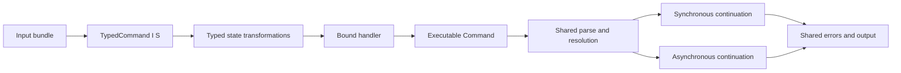

# Typed command binding and executor-independent async execution

Status: Implemented for review.

## Requirements

Handlers need a compile-time connection to their declared inputs and derived
state. Values must remain native, including borrowed, non-Clone application
types. Existing commands, config, provenance, plugins, help, completions, and
injected runtimes must keep working. Async callbacks must borrow their inputs
across suspension without requiring a framework-selected executor. CI must
verify portable behavior and live compatibility against a recorded TS revision.

## Decision

`Command::inputs` registers a sealed input bundle and retains its type until
`.action` or `.action_async` binds the handler. Individual inputs and nested
tuples work without macros. Callbacks receive borrowed native values and a
`Scope` containing output, metadata, and provenance. Scope has no dynamic input
or state accessor. Input bundles can be cloned for shared globals: register the
flag bundle at the CLI root and include it in each typed leaf's bundle. Leaf
registration guarantees availability independently of runtime propagation.

Typed derives transform owned state `S` into `T`. Earlier state can be retained
explicitly in a tuple or application struct. This avoids type-map replacement
and allows local state such as `Rc` without requiring `Send + Sync` on the state
value. Closure captures remain `Send + Sync` so command definitions remain
shareable. State is created afresh per invocation and is dropped on failure or
future cancellation. State cannot borrow invocation inputs: use owned state or
read the borrowed inputs alongside state in the action.

Async callbacks use Rust async closures and internally boxed local futures.
They may borrow context and hold non-Send values across suspension. Async
continuations are consuming, just like synchronous continuations. The CLI shares
preparation and result finalization across both execution paths. Filesystem,
config, prompts, and stdio preparation remain synchronous. Tokio is an example
and test dependency only; the framework has no executor dependency.

Synchronous middleware cannot synchronously wrap an awaited continuation.
Reject that combination before execute hooks or middleware effects and suggest
`middleware_async`. An async middleware may wrap an entirely synchronous tail;
synchronous derives work in both execution paths. A sync runner rejects commands
requiring async execution before execute hooks and derives. Help, version, and
completion requests still work synchronously without running application code.

## Alternatives and consequences

- Unique handle IDs improve runtime identity but cannot prove registration or
  state availability. Keep the dynamic API as an explicit alternative.
- A generic builder accumulating a heterogeneous input list through each `.flag`
  call would preserve more existing syntax, but selecting arbitrary entries
  creates more trait and diagnostic complexity. Bound tuples provide a compact,
  auditable boundary. A named-struct frontend can be added later.
- Implicit accumulation of arbitrary state types would need indexed products or
  generated field names. Owned state transformations make retained state explicit.
- Requiring Send futures would exclude useful local application state and needs
  additional bounds on lending async closures. Local futures support directly
  awaiting an invocation; callers cannot spawn those futures on a multithreaded
  executor's Send-only spawn API.
- Separate async preparation would duplicate resolution behavior. Sharing it
  preserves builtin priority, runtime injection, errors, and plugin hooks.

CI runs core checks on Linux, macOS, and Windows, external shells and PTY tests on
Linux, and regenerates expectations in memory from the pinned TS checkout.
Reference checks compare JSON semantically without overwriting recorded files.
The native lifecycle tests additionally verify plugin failures and cancellation.
Rust records a failed activity finish on Drop; TS capture omits a framework
cleanup event after an action error. The lifecycle comparison names this
intentional difference explicitly rather than dropping it from the fixtures.
