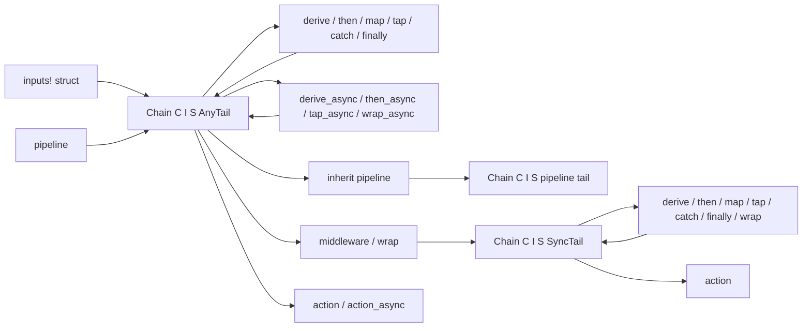

# Named input bundles and typed middleware

Status: Implemented for review.

## Requirements

Commands with several inputs need field names in their handlers. A named
frontend must register inputs and fix callback types in the same step as
`.inputs(...)`, keep the sealed reader boundary, and nest shared globals.
Middleware on typed commands needs an explicit position relative to derivation,
defined short-circuit and cleanup behavior, and the existing sync/async rules.
The manifest example (`crates/fujo/examples/manifest.rs`) exercises both with
shared globals, two commands, asynchronous fingerprinting, and terminal output.

## Decision

`fujo::inputs!` declares a bundle struct and its values struct. Field types are
input handles, tuples, or other bundles; the macro implements `InputSet` by
visiting and reading each field, so a declared struct delivers values of its
declared fields only. The seal is reachable through one hidden module used by
the macro. Field types constrain the handles supplied at construction, so a
handle of the wrong surface, value type, or presence fails where the struct is
built. `fujo::flags!` adds `FlagSet` with a per-field bound, so a positional
field is rejected at the declaration. Bundles are `Clone` and value structs are
`Copy`, so a global bundle registers once at the root and once in each leaf.

The macro requires the handle type for each field, such as `Flag<u16, Required>`.
A derive macro could infer these from construction and would need a proc-macro
crate; `macro_rules` keeps the workspace free of `syn` and `quote` and keeps
the declaration explicit.

Typed middleware is a stage. The pipeline runs stages in declaration order; a
middleware receives the state derived by earlier stages by value and a
continuation that runs every later stage and the action. It hands the state to
`next.run`, or drops the continuation to short-circuit, which drops the state.
It regains control with the result of the later stages and may replace it.
Internally each stage composes continuations: a stage transforms the
continuation of its output into a continuation of the initial state. Wrapping
therefore needs no runtime type map, and derived state never enters `Context`.

A synchronous middleware receives a synchronous continuation. The builder
records this in a third type parameter: after `.middleware()` the command is
`TypedCommand<I, S, SyncTail>`, which offers `derive`, `middleware`, and
`action` only. `middleware_async` keeps `AnyTail`. The dynamic
`ASYNC_MIDDLEWARE_REQUIRED` runtime check has no typed counterpart at runtime;
the combination fails to compile. Asynchronous derives followed by a
synchronous middleware are allowed; the synchronous tail runs inside the
asynchronous invocation.

Dynamic `.middleware()` on `Command` wraps the whole typed pipeline, including
derivation, and receives `Context`. Typed middleware wraps later typed stages
and receives `Scope`, the bundle values, and typed state.

Stages are values. `Derive`, `AsyncDerive`, `Middleware`, and `AsyncMiddleware`
are public traits with blanket implementations for closures of the matching
shape; `then`, `then_async`, `wrap`, and `wrap_async` accept any implementor.
A struct implementing a trait generically over the bundle serves every
command, which closures cannot, since each bundle's values type is
higher-ranked over its lifetime. `derive` and `middleware` keep closure bounds
so closure parameters stay inferred. `Arc<T>` has no implementation: the
asynchronous closure traits are not fundamental, so such an implementation
would overlap with the closure one.

`tap`, `map`, `catch`, and `finally` are stages with fixed shapes. `tap` and
`map` are derives, so they keep the tail type. `catch` and `finally` handle
both continuation kinds and keep the tail type too; their handlers are
synchronous. Timeouts need a timer, which the crate does not own, and retries
need a re-runnable continuation, which the one-shot `Next` is not; neither is
provided.

The builder is `Chain<C, I, S, M>` with carrier `C`: `Command` for a
`TypedCommand`, `()` for a `Pipeline`. One method set serves both. `inherit`
composes a pipeline's stages after the command's own stages declared so far,
so a pipeline middleware wraps the command's later stages and action. It is
available while the command's state is `()` and its tail is `AnyTail`; the
pipeline's state and tail carry over. A pipeline reads its inputs by name from
the resolved invocation and registers nothing itself, so the inheriting command
or the root must register them. The alternative, running the shared stages at
the root before dispatch, would hand state across the type-erased command
boundary through `Context`, which requires `Send`, a runtime presence check, and
cannot let a shared middleware wrap the child.

Every builder records a `StageInfo` per stage: kind, handler type name, and
whether it is asynchronous. `Command::stages()` lists dynamic steps first, then
typed stages, in execution order.

## Alternatives and consequences

- Middleware receiving `&S` while the continuation owns the state: later derives
  consume state by value, so a borrow held across `next.run` would block them.
  Passing state through keeps the linear ownership model of derives.
- Restricting typed middleware to wrap the action alone: simpler, but a
  middleware could then wrap no later derivation, such as the manifest
  example's fingerprinting.
- Runtime validation of sync/async mixing for typed commands: the type-state
  costs one marker parameter and removes a class of runtime failures.
- Friction observed in the manifest example and left in place: `describe`,
  `example`, and `alias` are `Command` methods, so they precede `.inputs(...)`.
- `inherit` requires `()` state. A command that derives state before inheriting
  would need the pipeline to thread that state through, which means a tuple
  state for every inheritor; the manifest example moves its pre-scan check into
  a `tap` instead.
